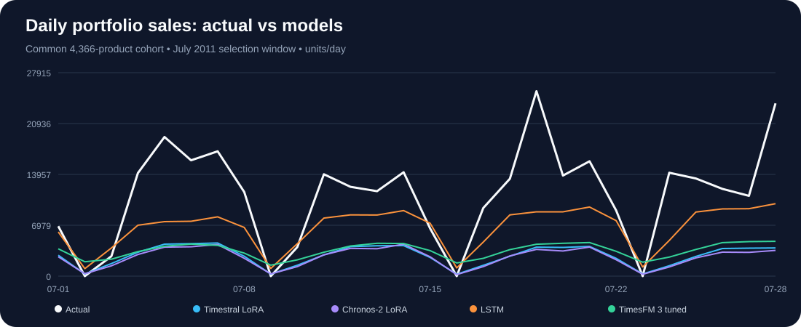

# RetailMind AI · Demand Forecasting & Inventory Decisions

**From historical sales to forecasts, uncertainty and actionable inventory proposals.**

RetailMind brings together retail data analysis, a comparison of 15 forecasting candidates, probabilistic forecasts and a containerized API for inventory decision support.


A caller sends daily sales history → Timestral forecasts quantities → calibrated daily intervals show uncertainty → inventory rules combine forecasts with stock and lead time → the API returns an order proposal and scenario results. Proposals are advisory; the service does not place orders.

## Data & exploration

The research uses historical transaction data ending in **2011**. Transactions were cleaned and aggregated into daily product sales; cancellations, non-product codes, missing dates and price features were investigated. A frozen cohort of **4,366 products** was used for the common model comparison. A zero in the series represents zero *recorded sales*, which can include stockouts or unavailable products.

Explore the interactive [data dashboard](reports/data-exploration.html), [feature analysis](reports/feature-eda.html), and [product-code audit](reports/code-family-audit.html). See [data setup](data/README.md) and [feature inventory](docs/feature-inventory.md) for the inputs and transformations. Download the repository and open HTML files in a browser; GitHub displays HTML as source.

## Evaluation & model comparison

**15 model variants · 4,366 products · 28 forecast days · 122,248 scored product-days per candidate**

The common model-selection window is **1–28 July 2011**. Forecasts were frozen before scoring on the same product-date keys. Timestral 209M LoRA led on pooled MAE at **2.331**, narrowly ahead of Chronos-2 LoRA at **2.346**—roughly a **0.6%** difference. TimesFM 2.5 LoRA had the lowest RMSE, showing how model choice depends on the metric.



*Daily portfolio totals on the common selection cohort. The model lines are saved predictions, and the white line is recorded sales.*


*Illustrative product 21976, 12 November–9 December 2011. Shading shows the saved calibrated daily bounds; it is not a calibrated interval for the sum of the 28 days.*


| Model | MAE ↓ | RMSE ↓ | WAPE ↓ | Mean inference ms/product* |
|---|---:|---:|---:|---:|
| Timestral 209M LoRA | 2.331 | 19.488 | 91.6% | 11.44 |
| Chronos-2 LoRA | 2.346 | 19.551 | 92.2% | 6.90 |
| Chronos-2 zero-shot | 2.363 | 19.490 | 92.9% | 2.93 |
| Toto 2.0 custom LoRA | 2.363 | 19.662 | 92.9% | 2.35 |
| Timestral 209M zero-shot | 2.365 | 19.473 | 93.0% | 7.27 |
| TiRex-2 head-tuned | 2.403 | 19.723 | 94.5% | 26.39 |
| TiRex-2 zero-shot | 2.409 | 19.666 | 94.7% | 27.77 |
| TimesFM 2.5 zero-shot | 2.410 | 19.457 | 94.7% | 12.58 |
| Toto 2.0 zero-shot | 2.429 | 19.590 | 95.5% | 1.82 |
| TimesFM 3.0 head-tuned | 2.511 | 20.209 | 98.7% | 181.88 |
| TimesFM 3.0 zero-shot | 2.553 | 20.291 | 100.4% | 151.13 |
| LSTM | 2.562 | 19.018 | 100.7% | 19.14 |
| TimesFM 2.5 LoRA | 3.063 | 18.971 | 120.4% | 18.86 |
| Seasonal naive | 3.435 | 24.310 | 135.0% | 0.00 |
| LightGBM | 5.110 | 19.707 | 200.9% | 2.08 |


*Latency is the recorded batch-run time divided by products, not a controlled single-request comparison. Models used different batch sizes and execution paths.*

**Evaluation limits:** July selected the model; it is not an untouched final test. The October window was reused. The packaged LoRA adapter comes from the earlier validation run; the exact October checkpoint was not retained, so October scores cannot be attributed to the deployed checkpoint. See the [interactive comparison](reports/comparison/validation-comparison.html), [evaluation guide](reports/evaluation.html), [methodology](docs/validation-comparison.md), [scorecard](reports/comparison/scorecard.json), and [evaluation scripts](scripts/foundation_models/).

## Forecast API

FastAPI provides single and batch forecasts, P10/P50/P90 and calibrated bounds, chronological holdout evaluation, reorder proposals and supply scenarios. OpenAPI documentation is served at `/docs`. [API visual guide](reports/api.html) · [API reference](docs/forecast-api.md)

## Docker & deployment

The image packages the pinned Timestral base weights, fine-tuned adapter and API. A local container passed real inference, interval, evaluation and inventory smoke checks. GPU inference is configured with a 2 GiB PyTorch allocator cap. [Docker guide](reports/docker.html) · [Deployment details](docs/docker/README.md)

```bash
docker build -t retailmind-ai-forecasting:local .
docker run --rm -p 8000:8000 retailmind-ai-forecasting:local
# API docs: http://localhost:8000/docs
```

Add `--gpus all` when the NVIDIA container runtime is available. Review the [model license](models/timestral209m_lora/LICENSE) before distributing the image.

## CI/CD

GitHub Actions builds the image, starts the service and runs a real-model API smoke test. A successful run on `main` publishes the tested image when the `DOCKERHUB_USERNAME` and `DOCKERHUB_TOKEN` repository secrets are configured; otherwise publication is skipped with a warning. [CI/CD guide](reports/cicd.html) · [Workflow](.github/workflows/docker-image-ci.yml)

## More analysis

[Uncertainty report](reports/milestone2-uncertainty.html) · [Inventory simulation](reports/milestone3-inventory.html) · [Scenario analysis](reports/milestone4-scenarios.html) · [Model evaluation dashboard](reports/model-evaluation.html)
