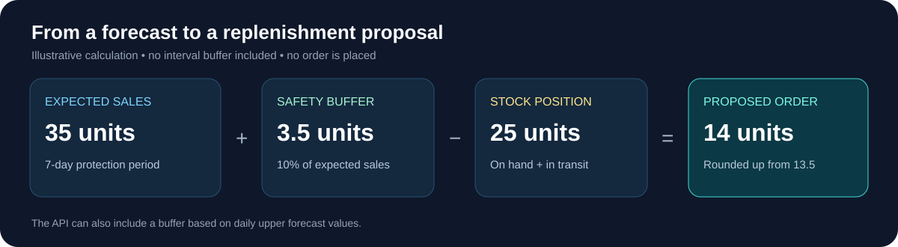

# RetailMind AI · Demand Forecasting & Inventory Decisions

**A practical way to turn retail sales history into demand forecasts and inventory decisions.**

Retailers need to decide what to replenish before the next delivery arrives. Ordering too little can leave shelves empty; ordering too much can tie up cash and warehouse space. RetailMind is a forecasting and decision-support prototype that helps a planner examine those trade-offs for each product.

The service takes **consecutive daily sales quantities for a product** and predicts the quantity expected to be sold on each of the next **1–28 days**. It returns a central forecast and a range of plausible outcomes. A planner can combine those forecasts with stock on hand, incoming stock, supplier lead time and review period to calculate a suggested replenishment quantity, then explore what could happen if demand rises or a delivery is late. The suggestion supports a human decision; it does not place an order.


[Download the shareable MP4](docs/images/retailmind-production.mp4) · [Download the GIF](docs/images/production-flow.gif)

### How the solution works

1. **Prepare the history.** Clean retail transactions and aggregate recorded sales into daily product series. The API accepts a caller's daily quantities; it does not require the original dataset at inference time.
2. **Forecast quantities.** A fine-tuned Timestral 209M model estimates future daily sales for the requested horizon.
3. **Express uncertainty.** P10, P50 and P90 forecasts and historically calibrated daily bounds show a range around the central estimate.
4. **Plan replenishment.** Inventory rules combine the forecast with on-hand and incoming stock, lead time, review period and a safety buffer to produce a proposed order.
5. **Explore scenarios.** Simulate demand changes and delivery delays to inspect projected fulfillment and unmet units before acting.

For technical readers, the project compares **15 model variants on 4,366 products**, exposes the selected model through FastAPI, packages it in Docker with a 2 GiB GPU allocator cap, and runs real inference and decision checks in GitHub Actions. The historical data measures **recorded sales**, not demand lost during stockouts; results and inventory simulations should be validated with current operational data before business use.

## What a business can do with the forecast

**Plan purchasing.** A planner can see expected product sales during the supplier lead time and review period, compare them with available and incoming stock, and review a proposed order quantity. This gives the team a consistent starting point for replenishment conversations.

**See uncertainty.** A single forecast can hide how much outcomes vary. Daily P10, P50 and P90 predictions show lower, central and upper estimates. The saved historical calibration supplies additional daily bounds; they should be monitored and recalibrated against recent data before operational use.

**Ask “what if?”** The scenario endpoint lets the planner change a demand multiplier and inbound delivery timing, then inspect projected fulfilled and unmet units. This helps explore a supplier delay or demand spike before making a decision.

**Keep people in control.** The API returns an explanation and a proposed quantity. It cannot submit purchase orders or change inventory. Forecasts are estimates of recorded sales; the research dataset has no actual stock levels, supplier lead times or lost-sales records.



*Illustration only:* if seven days of forecast demand total 35 units, a 10% safety fraction adds 3.5 units and stock on hand plus in transit totals 25 units, the API proposes **14 units** after rounding up. No interval buffer is included in this example. The protection period must fit within the supplied forecast horizon. See the [inventory API reference](docs/forecast-api.md#other-operations).

## Try the forecasting API

After starting the container using the [Docker instructions](#docker--deployment), send seven consecutive days of recorded sales. This request asks for a one-day forecast:

```bash
curl -X POST http://localhost:8000/api/v1/forecast \
  -H 'Content-Type: application/json' \
  -d '{"series":{"series_id":"SKU-1001","history":[
    {"date":"2025-01-01","quantity":4},
    {"date":"2025-01-02","quantity":0},
    {"date":"2025-01-03","quantity":7},
    {"date":"2025-01-04","quantity":2},
    {"date":"2025-01-05","quantity":3},
    {"date":"2025-01-06","quantity":5},
    {"date":"2025-01-07","quantity":1}
  ]},"horizon_days":1}'
```

A real run of the packaged model returned the following **shortened and rounded** response; the full response also includes model metadata and timing:

```json
{
  "series_id": "SKU-1001",
  "forecast_origin": "2025-01-07",
  "horizon_days": 1,
  "methods": {
    "timestral209m_lora": {
      "predictions": [{
        "date": "2025-01-08",
        "demand_units": 3.411,
        "p10": 0.0,
        "p50": 3.411,
        "p90": 7.072,
        "calibrated_lower": 0.0,
        "calibrated_upper": 7.072
      }]
    }
  }
}
```

P50 is the central daily forecast; the other values express daily uncertainty. Results and timing may vary by hardware and inputs. See the [API reference](docs/forecast-api.md) for batch forecasts, evaluation and inventory requests.

## Data & exploration

The research uses the **UCI Online Retail II** UK retailer dataset: **1,067,371 transaction lines** across two workbook sheets from 2009–2011. The cleaning audit records **1,037,019 included lines** after the configured exclusions; these are transaction rows, not products. Transactions were cleaned and aggregated into daily product sales; cancellations, non-product codes, missing dates and price features were investigated. A frozen cohort of **4,366 products** was used for the common model comparison. A zero in the series represents zero *recorded sales*, which can include stockouts or unavailable products. The dataset does not reveal product quality, production country or unsatisfied demand.

Explore the interactive [data dashboard](https://bmaged23.github.io/retailmind-ai-forecasting/reports/data-exploration.html), [feature analysis](https://bmaged23.github.io/retailmind-ai-forecasting/reports/feature-eda.html), and [product-code audit](https://bmaged23.github.io/retailmind-ai-forecasting/reports/code-family-audit.html). See [data setup](data/README.md) and [feature inventory](docs/feature-inventory.md) for the inputs and transformations. The dashboards open directly in your browser on [RetailMind Reports](https://bmaged23.github.io/retailmind-ai-forecasting/).

## Evaluation & model comparison

**15 model variants · 4,366 products · 28 forecast days · 122,248 scored product-days per candidate**

The common model-selection window is **1–28 July 2011**. Forecasts were frozen before scoring on the same product-date keys. Timestral 209M LoRA led on pooled MAE at **2.331**, narrowly ahead of Chronos-2 LoRA at **2.346**—roughly a **0.6%** difference. TimesFM 2.5 LoRA had the lowest RMSE, showing how model choice depends on the metric.


*Daily portfolio totals on the common selection cohort. The model lines are saved predictions, and the white line is recorded sales.*


*Illustrative product 21976, 12 November–9 December 2011. Shading shows the saved calibrated daily bounds; it is not a calibrated interval for the sum of the 28 days.*


| Model | MAE ↓ | RMSE ↓ | WAPE ↓ | Mean inference ms/product* |
|---|---:|---:|---:|---:|
| Timestral 209M LoRA | 2.331 | 19.488 | 91.6% | 11.44 |
| Chronos-2 LoRA | 2.346 | 19.551 | 92.2% | 6.90 |
| Chronos-2 zero-shot | 2.363 | 19.490 | 92.9% | 2.93 |
| Toto 2.0 custom LoRA | 2.363 | 19.662 | 92.9% | 2.35 |
| Timestral 209M zero-shot | 2.365 | 19.473 | 93.0% | 7.27 |
| TiRex-2 head-tuned | 2.403 | 19.723 | 94.5% | 26.39 |
| TiRex-2 zero-shot | 2.409 | 19.666 | 94.7% | 27.77 |
| TimesFM 2.5 zero-shot | 2.410 | 19.457 | 94.7% | 12.58 |
| Toto 2.0 zero-shot | 2.429 | 19.590 | 95.5% | 1.82 |
| TimesFM 3.0 head-tuned | 2.511 | 20.209 | 98.7% | 181.88 |
| TimesFM 3.0 zero-shot | 2.553 | 20.291 | 100.4% | 151.13 |
| LSTM | 2.562 | 19.018 | 100.7% | 19.14 |
| TimesFM 2.5 LoRA | 3.063 | 18.971 | 120.4% | 18.86 |
| Seasonal naive | 3.435 | 24.310 | 135.0% | 0.00 |
| LightGBM | 5.110 | 19.707 | 200.9% | 2.08 |


### Interpreting the results

- **Why Timestral?** It had the lowest pooled MAE on the common July selection window: **2.331 units per product per day**, versus **3.435** for seasonal naive. Chronos-2 LoRA was close at **2.346**, so this was a competitive selection rather than a runaway win.
- **What does WAPE mean?** The selected model’s pooled WAPE was **91.6%** on this sparse historical dataset. It is the absolute error summed across all predictions divided by total recorded sales, and it shows that the task remained difficult even for the leading candidate.
- **How wide are the intervals?** In a separate November–December historical evaluation, the daily P10–P90 interval covered **91.53%** of observations, with mean width **10.159 units**. That is above the nominal 80% interval; coverage is not guaranteed for each product or for future business data. [Uncertainty report](https://bmaged23.github.io/retailmind-ai-forecasting/reports/milestone2-uncertainty.html) · [Method and limitations](docs/milestone2-uncertainty.md).
- **What about inventory savings?** The inventory study used synthetic stock and supplier assumptions, because those fields were absent from the dataset. Its outcomes are simulations, not measured business savings. [Inventory report](https://bmaged23.github.io/retailmind-ai-forecasting/reports/milestone3-inventory.html) · [Scenario report](https://bmaged23.github.io/retailmind-ai-forecasting/reports/milestone4-scenarios.html).

*Latency is the recorded batch-run time divided by products, not a controlled single-request comparison. Models used different batch sizes and execution paths.*

**Evaluation limits:** July selected the model; it is not an untouched final test. The October window was reused. The packaged LoRA adapter comes from the earlier validation run; the exact October checkpoint was not retained, so October scores cannot be attributed to the deployed checkpoint. See the [interactive comparison](https://bmaged23.github.io/retailmind-ai-forecasting/reports/comparison/validation-comparison.html), [evaluation guide](https://bmaged23.github.io/retailmind-ai-forecasting/reports/evaluation.html), [methodology](docs/validation-comparison.md), [scorecard](reports/comparison/scorecard.json), and [evaluation scripts](scripts/foundation_models/).

## Forecast API

FastAPI provides single and batch forecasts, P10/P50/P90 and calibrated bounds, chronological holdout evaluation, reorder proposals and supply scenarios. OpenAPI documentation is served at `/docs`. [API visual guide](https://bmaged23.github.io/retailmind-ai-forecasting/reports/api.html) · [API reference](docs/forecast-api.md)

| What you send | What you get | Why it helps |
|---|---|---|
| Consecutive daily sales and a 1–28 day horizon | Daily P10/P50/P90 forecasts and interval bounds | Inspect expected demand and uncertainty by day |
| A forecast, stock on hand, incoming stock and lead time | A proposed order quantity and its components | Review replenishment needs and safety assumptions |
| Forecast demand, stock and a delivery scenario | Daily simulated fulfillment and unmet units | Explore a delay or demand change |
| Historical observations and a holdout length | MAE, RMSE, WAPE and MASE when defined | Check a forecast on a chronological holdout |

The deployed model uses the supplied **quantity history**. Product descriptions, country and price were explored during research; they are not required or consumed by this deployment’s forecast request.

## Docker & deployment

The image packages the pinned Timestral base weights, fine-tuned adapter and API. [Docker Hub repository](https://hub.docker.com/r/bmaged23/retailmind-ai-forecasting). A local container passed real inference, interval, evaluation and inventory smoke checks. GPU inference is configured with a 2 GiB PyTorch allocator cap. [Docker guide](https://bmaged23.github.io/retailmind-ai-forecasting/reports/docker.html) · [Deployment details](docs/docker/README.md)

```bash
# Pull and run the tested image.
docker pull bmaged23/retailmind-ai-forecasting:latest
docker run --rm -p 8000:8000 bmaged23/retailmind-ai-forecasting:latest
# API docs: http://localhost:8000/docs
```

Add `--gpus all` when the NVIDIA container runtime is available. Review the [model license](models/timestral209m_lora/LICENSE) before distributing the image.

## CI/CD

GitHub Actions builds the image, starts the service and runs a real-model API smoke test. A successful run on `main` publishes the tested image when the `DOCKERHUB_USERNAME` and `DOCKERHUB_TOKEN` repository secrets are configured; otherwise publication is skipped with a warning. [CI/CD guide](https://bmaged23.github.io/retailmind-ai-forecasting/reports/cicd.html) · [Workflow](.github/workflows/docker-image-ci.yml)

## Reports and reproducibility

The [interactive report hub](https://bmaged23.github.io/retailmind-ai-forecasting/) opens every dashboard in your browser. The [report index](reports/README.md) links each HTML dashboard to its supporting README, source and limitations. Forecast CSVs, raw data and other generated artifacts are excluded from Git; the checked-in [selection scorecard](reports/comparison/scorecard.json) and evaluation scripts document the reported comparison.

## More analysis

[Uncertainty report](https://bmaged23.github.io/retailmind-ai-forecasting/reports/milestone2-uncertainty.html) · [Inventory simulation](https://bmaged23.github.io/retailmind-ai-forecasting/reports/milestone3-inventory.html) · [Scenario analysis](https://bmaged23.github.io/retailmind-ai-forecasting/reports/milestone4-scenarios.html)

## License and attribution

The original project code and documentation are available under the [MIT License](LICENSE), copyright © 2026 Nessim Bola. MIT permits commercial use and requires the copyright and license notice to be retained. Third-party components have their own terms: in particular, the bundled Timestral base model and LoRA adapter are subject to the separate [Mistral Modified MIT model license](models/timestral209m_lora/LICENSE), including its monthly-revenue restriction. The [Online Retail II dataset](data/README.md) has its own CC BY 4.0 terms. The project code license does not override those third-party licenses.
