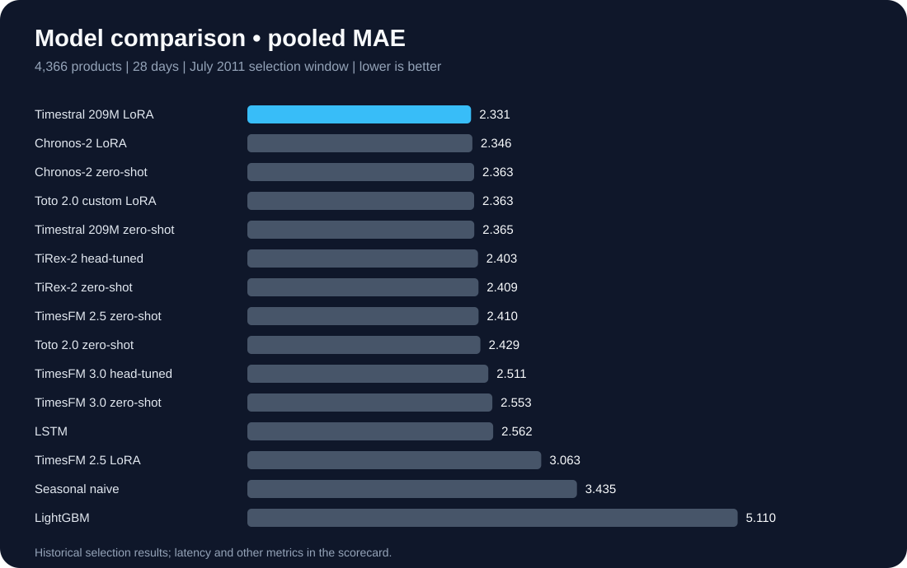

# RetailMind AI · Retail Demand Forecasting

**Forecast demand. Quantify uncertainty. Support inventory decisions.**

RetailMind is an end-to-end retail forecasting project: exploratory analysis, a common-cohort comparison of statistical, neural and foundation models, probabilistic forecasts, inventory simulations, and a containerized FastAPI service. The selected deployment uses a fine-tuned Timestral 209M LoRA adapter.

**4,366 products** · **15 candidate variants** · **28-day horizon** · **122,248 predictions per candidate**



## Model comparison

All candidates below were scored on the same product-date keys for **1–28 July 2011**. Pooled MAE selected the winner; RMSE and WAPE provide additional views. The lead was close: Timestral LoRA's MAE was **2.331**, compared with **2.346** for Chronos-2 LoRA, a difference of about **0.6%**. TimesFM 2.5 LoRA had the lowest RMSE, so the winner depends on the metric.

| Model | MAE ↓ | RMSE ↓ | WAPE ↓ | Mean inference ms/product* |
|---|---:|---:|---:|---:|
| Timestral 209M LoRA | 2.331 | 19.488 | 91.6% | 11.44 |
| Chronos-2 LoRA | 2.346 | 19.551 | 92.2% | 6.90 |
| Chronos-2 zero-shot | 2.363 | 19.490 | 92.9% | 2.93 |
| Toto 2.0 custom LoRA | 2.363 | 19.662 | 92.9% | 2.35 |
| Timestral 209M zero-shot | 2.365 | 19.473 | 93.0% | 7.27 |
| TiRex-2 head-tuned | 2.403 | 19.723 | 94.5% | 26.39 |
| TiRex-2 zero-shot | 2.409 | 19.666 | 94.7% | 27.77 |
| TimesFM 2.5 zero-shot | 2.410 | 19.457 | 94.7% | 12.58 |
| Toto 2.0 zero-shot | 2.429 | 19.590 | 95.5% | 1.82 |
| TimesFM 3.0 head-tuned | 2.511 | 20.209 | 98.7% | 181.88 |
| TimesFM 3.0 zero-shot | 2.553 | 20.291 | 100.4% | 151.13 |
| LSTM | 2.562 | 19.018 | 100.7% | 19.14 |
| TimesFM 2.5 LoRA | 3.063 | 18.971 | 120.4% | 18.86 |
| Seasonal naive | 3.435 | 24.310 | 135.0% | 0.00 |
| LightGBM | 5.110 | 19.707 | 200.9% | 2.08 |


*Latency is reported as mean seconds divided by products in each recorded run, converted to milliseconds. Models used different batch sizes and execution paths; it is **not** a controlled single-request latency comparison. The deployed container smoke test measured approximately 9.3 seconds for one first forecast request including model loading.

**Interpretation:** July was used for model selection, not an untouched final test. The October evaluation was reused. The bundled adapter comes from the earlier validation run; the exact October checkpoint was not retained, so October scores cannot be attributed to the packaged checkpoint. Observed sales can be censored by stockouts. The data ends in 2011.

## Explore the project

| Area | Visual guide | Technical details |
|---|---|---|
| Model evaluation | [Evaluation dashboard](reports/comparison/validation-comparison.html) · [Evaluation guide](reports/evaluation.html) | [Evaluation README](docs/evaluation/README.md) · [scorecard](reports/comparison/scorecard.json) |
| Forecast API | [API guide](reports/api.html) | [API README](docs/api/README.md) · [endpoint reference](docs/forecast-api.md) |
| Docker deployment | [Docker guide](reports/docker.html) | [Deployment README](docs/docker/README.md) |
| CI/CD | [CI/CD guide](reports/cicd.html) | [CI/CD README](docs/cicd/README.md) · [workflow](.github/workflows/docker-image-ci.yml) |
| Data & features | [Data exploration](reports/data-exploration.html) · [Feature EDA](reports/feature-eda.html) | [Feature inventory](docs/feature-inventory.md) |
| Decisions | [Uncertainty](reports/milestone2-uncertainty.html) · [Inventory](reports/milestone3-inventory.html) · [Scenarios](reports/milestone4-scenarios.html) | [Inventory methodology](docs/milestone3-inventory.md) |

GitHub displays HTML files as source; download the repository and open these reports in a browser to use the dashboards.

## Quick start

```bash
docker build -t retailmind-ai-forecasting:local .
docker run --rm -p 8000:8000 retailmind-ai-forecasting:local
# Open http://localhost:8000/docs
```

For NVIDIA GPU inference add `--gpus all`; the service caps the PyTorch allocator at 2,048 MiB. The image includes the base model and adapter. Review [model license](models/timestral209m_lora/LICENSE) before distributing the image. See [deployment](docs/docker/README.md) for smoke tests and operating details.

---

## Milestone 1: demand forecasting — comparison complete

The project compares seasonal naive, LightGBM, a global LSTM, and zero-shot and
adapted variants of Chronos-2, Timestral 209M, TimesFM 2.5 and 3.0, Toto 2.0,
and TiRex-2. On the common July 2011 model-selection window, Timestral 209M LoRA
leads with pooled MAE 2.3314 across 4,366 products and 28 days. This is a
validation leader, not an unbiased final benchmark: July was used for model
selection, the October window was previously reused, and the historical source
ends in 2011. See the [validation comparison](docs/validation-comparison.md)
and the local dashboard at
`artifacts/validation_comparison_2011-07-01_to_2011-07-28/validation-comparison.html`.

## Milestone 2: probabilistic forecasting — historical study complete

The selected Timestral LoRA model supplies P10/P50/P90 forecasts. Horizon-wise
conformal calibration used August 2011; a later November–December period was
scored separately. The central 80% interval covered 91.53% of product-day
observations, with a mean width of 10.159 units. Calibration corrections were
zero because the raw model intervals already overcovered the nominal target on
the calibration period. This is an empirical historical result, not a formal
per-product guarantee. Read the [Milestone 2 method and limits](docs/milestone2-uncertainty.md)
and the [Milestone 2 dashboard](reports/milestone2-uncertainty.html).

## Milestone 3: inventory optimization — simulation prototype complete

A single-cycle simulator compares Timestral P50 plus a P90 safety-buffer
heuristic against seasonal-naive order-up-to for the same frozen 4,366-product
cohort and seeded synthetic stock/lead-time scenarios. In the configured
November–December 2011 replay, simulated fill rates were 75.33% and 46.35%,
respectively. The cost difference is assumption-dependent and is not measured
business savings: the source has no inventory, supplier, or lost-demand data.
See the [Milestone 3 method, assumptions, result, and limitations](docs/milestone3-inventory.md)
and the [inventory simulation dashboard](reports/milestone3-inventory.html).

## Milestone 4: business scenario simulation — prototype complete

Timestral, the trained LSTM, and Google TimesFM 3.0 head-tuned each generated
an order plan; all three were compared over 500 paired futures with the same
recorded-demand path, demand spikes, delivery delays, and starting-stock
losses. Mean simulated fill rates were 27.56%, 28.60%, and 26.26%,
respectively. LSTM had the best modeled fill and cost in this configured
simulation, while Timestral had lower forecast MAE. The reused evaluation
window and synthetic inventory/cost inputs make this descriptive, not a blind
business result. See the
[Milestone 4 method and limitations](docs/milestone4-scenarios.md) and
[scenario dashboard](reports/milestone4-scenarios.html).

## Milestone 5: business dashboard and assistant — local MVP

The FastAPI dashboard displays model forecasts, interval results, projected
stock, proposed orders, and scenario tools. Its local assistant explains
structured results and can call only the scenario and recommendation tools; it
cannot place purchases. The MVP uses a deterministic intent router rather than
a generative LLM. See the [Milestone 5 guide](docs/milestone5-dashboard.md).

## Milestone 6: local deployment and MLOps foundation — in progress

Docker Compose packages the selected Timestral 209M LoRA forecaster, its
pretrained base weights, and a daily data/artifact monitor. The API returns
daily P10/P50/P90 forecasts and calibrated bounds, and supports batch requests,
chronological holdout evaluation, reorder proposals, and inventory scenarios.
The included adapter is from the earlier validation run; the exact October
test-run checkpoint was not retained, so the October winning scores must not
be attributed to this packaged adapter. The monitor
records fingerprints, historical MAE, latency, interval coverage, and input
freshness; it correctly flags this 2011-only source as stale and does not
trigger automated inference or retraining. See the [Forecast API guide](docs/forecast-api.md)
and [Milestone 6 runbook](docs/milestone6-mlops.md).

The GitHub Actions Docker workflow builds the production image and smoke-tests
forecasting, evaluation, and inventory decision endpoints on every pull request
and push to `main`. After a successful smoke test on `main`, it publishes the
same tested image to Docker Hub as `latest` and `sha-<commit>`. Configure the
repository secrets `DOCKERHUB_USERNAME` and `DOCKERHUB_TOKEN` before enabling
publishing. This workspace has not been initialized as a Git repository, so the
workflow has not yet run in GitHub.
The model weights are distributed under Mistral's Modified MIT license with a
monthly revenue condition; see `models/timestral209m_lora/LICENSE` before
publishing the image.

## Run the baseline

Install Python 3.11 or newer and [uv](https://docs.astral.sh/uv/), then run:

```sh
uv sync --locked --extra dev
uv run retailmind prepare data/raw/online_retail_II.xlsx
uv run retailmind backtest data/processed/daily_sales.csv --cutoff 2011-08-31 --cutoff 2011-09-30
uv run python -m pytest -q
```

Download the workbook from [UCI Online Retail II](https://archive.ics.uci.edu/dataset/502/online+retail+ii) and place it at the path above. The example dates are illustrative, not a selected test protocol. Raw and processed data and generated reports are excluded from Git.

See the [code map](docs/code-map.md), [feature inventory](docs/feature-inventory.md), and [engineered feature validation](docs/enriched-validation.md), and [LSTM feature ablation](docs/lstm-feature-ablation.md).

## Explore the data

Open [the standalone interactive dashboard](reports/data-exploration.html) to inspect trends, product concentration, zero-sales patterns and a searchable, sortable product table. The [executed data notebook](notebooks/01_data_exploration.ipynb) documents the analysis, and the [full product-feature review notebook](notebooks/03_full_product_feature_review.ipynb) contains a reproducible random sample and unique-value checks. To regenerate after preparing the data, run `uv sync --locked --extra dev` and `uv run python scripts/data_exploration.py`, or run all notebook cells. The dashboard embeds Plotly and works without an internet connection. The notebook and report explore the full dataset descriptively and are not a model-selection protocol.

## Data and limitations

Source: Chen, D. (2012), *Online Retail II*, UCI Machine Learning Repository, [DOI 10.24432/C5CG6D](https://doi.org/10.24432/C5CG6D), CC BY 4.0. It covers 2009–2011 and is not evidence of present-day retail performance. We retain positive-quantity, positive-price product transactions and audit excluded records. Returns and cancellation rows are excluded from gross sales. Identical rows are retained because they can be real transactions; do not import a workbook twice. Gaps between each product's first and last sale are filled with zero under an assumption of complete source coverage, which must be checked before drawing conclusions. Digit-prefixed codes and the reviewed alphabetic DCGS family and PADS are included; other alphabetic codes are excluded into a service/unclassified review bucket. This conservative heuristic can still omit real products and requires further review. The first and last product-sale dates do not establish product availability. Large quantities remain in the target pending an explicit outlier review.

The simple CLI baseline computes MAE and RMSE; WAPE and MASE are undefined when their denominators are zero. The separate API now provides input-driven point forecasts, holdout evaluation, and inventory decision-support endpoints; see the [Forecast API guide](docs/forecast-api.md). See also [the benchmark plan](docs/benchmark.md), [data validation and proposed protocol](docs/data-validation.md), and [cancellation sensitivity analysis](docs/cancellation-analysis.md).
